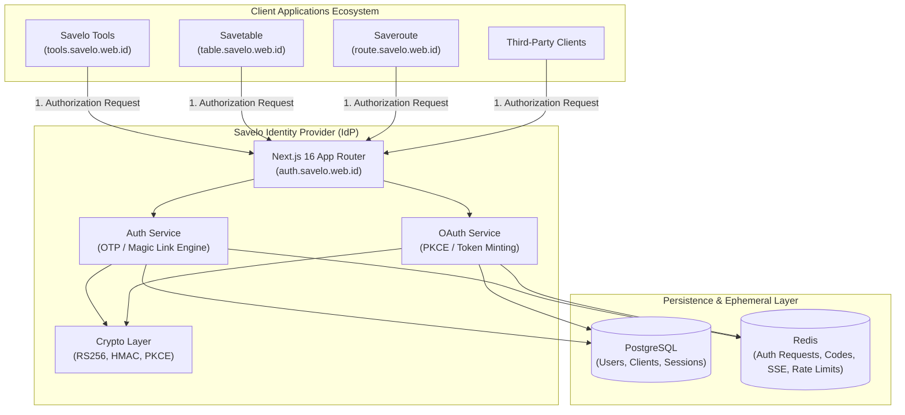

# Architecture Overview & Directives

This document details the system architecture, objectives, ecosystem topology, core architectural invariants, and approved Architectural Decision Records (ADRs) for the **Savelo Identity Provider (IdP)**.

---

## 1. System Mission & Context

Savelo IdP is a centralized Identity Provider engineered to serve a multi-application distributed ecosystem:
- **Savelo Tools:** Operational productivity utilities.
- **Savetable:** Data aggregation and reporting workspace.
- **Saveroute:** Route management and logistics engine.
- **Future Third-Party Clients:** Services integrating through standard OIDC protocols.

### Core Architecture Objectives:
1. **Zero Password Management:** No passwords, hashes, salts, or recovery questions are ever stored. User authentication is strictly ephemeral and cryptographically authenticated via One-Time Passwords (OTP) and Magic Links.
2. **Single Identity, Multi-Tenant Consumption:** A single user identity (email or phone) is recognized across all client applications with strict cross-app token audience isolation (`aud` claim).
3. **Backend-for-Frontend (BFF) Security:** Browser clients interact with the IdP through HTTP-Only cookies and server-to-server authorization code exchanges, preventing token theft via Cross-Site Scripting (XSS).
4. **Resilient Ephemeral State:** Short-lived state (OTP attempts, verification challenges, rate limits, Pub/Sub events) is offloaded to Redis with automatic TTL eviction, preserving database durability.

---

## 2. Core Directives for Engineering & AI Agents

Any engineer or automated AI agent modifying this codebase is bound to the following directives:

1. **Absolute Architectural Compliance:** Build strictly in alignment with this specification and approved ADRs. Do not alter core hashing algorithms, grant types, or session models without formal architect sign-off.
2. **No Unapproved Additions:** Do not introduce alternative login methods (e.g., social logins, passwords, WebAuthn) unless explicitly commissioned. Do not move tokens to browser local storage.
3. **Strict Security Protocols:** Time-constant comparison, RS256 token signing, PKCE validation, and Token Family RTR are mandatory non-negotiables. Never bypass these for convenience.
4. **Code Quality & Clean Architecture:** Maintain strict separation of concerns across:
   - `app/api/`: Request validation, cookie handling, HTTP response mapping.
   - `lib/services/`: Core business orchestration.
   - `lib/repositories/`: Data access layer for PostgreSQL and Redis.
   - `lib/crypto/`: Pure cryptographic primitives.

---

## 3. Architectural Decision Record: ADR-001

*Approved by Principal Architect (2026-11-04)*

### 1. Framework Modernization: Next.js 16 & React 19
- **Decision:** Utilize Next.js 16 App Router with React 19 Server Components and Route Handlers (`app/api/**/route.ts`).
- **Rationale:** Native asynchronous request handling, server-side execution boundary, high-performance edge/serverless compatibility, and built-in streaming/SSE capabilities.

### 2. OTP Cryptography: HMAC-SHA256 with Server Pepper
- **Decision:** Store OTP hashes generated using `HMAC-SHA256(rawOtp, AUTH_PEPPER_SECRET)` rather than simple SHA-256 or bcrypt.
- **Rationale:** 6-digit numeric OTPs have a small keyspace ($10^6$ combinations). Simple hashes are vulnerable to rainbow table precomputation. Combining with a high-entropy server-side pepper renders offline dictionary attacks infeasible.

### 3. Ephemeral State Migration to Redis
- **Decision:** Migrate `AuthRequest` state from PostgreSQL to Redis with automatic 10-minute TTL (`auth:req:{sessionStateID}`).
- **Rationale:** High write/expire churn on authentication attempts causes unnecessary PostgreSQL database bloat and connection overhead. Redis provides in-memory read/write speeds, native key expiration, and atomicity.

### 4. Cross-Device SSE Synchronization via Redis Pub/Sub
- **Decision:** Use Redis Pub/Sub channels (`auth:events:{sessionStateID}`) to push verification events from verifying devices to initiating desktop browsers via Server-Sent Events (SSE).
- **Rationale:** Instant, real-time push without database polling loops, supporting seamless cross-device mobile-to-desktop verification.

### 5. Refresh Token Rotation (RTR) with Token Families
- **Decision:** Add a `familyId` (UUID) column to PostgreSQL `Session` table. Every refresh request rotates the token. If an already-used refresh token is submitted, the system triggers immediate family revocation (`DELETE FROM "sessions" WHERE "familyId" = :familyId`).
- **Rationale:** Detects token theft and replay attacks immediately, invalidating any compromised session chains.

### 6. Cookie Policy: SameSite=Lax
- **Decision:** Session and authentication cookies utilize `HttpOnly=true`, `Secure=true`, and `SameSite=Lax`.
- **Rationale:** `SameSite=Strict` blocks cookies on top-level cross-subdomain navigations during OAuth redirects (e.g. from `tools.savelo.web.id` to `auth.savelo.web.id`). `SameSite=Lax` permits top-level GET redirects while preventing CSRF on state-changing requests.

### 7. UI Standards & Zero-Emoji Policy
- **Decision:** Emojis are strictly banned as UI icons or functional indicators. All iconography must use clean, vector SVGs from `lucide-react` with 2px stroke width and enterprise monochromatic palettes.
- **Rationale:** Guarantees a serious, authoritative cyber-defense and fintech aesthetic appropriate for core security infrastructure.
