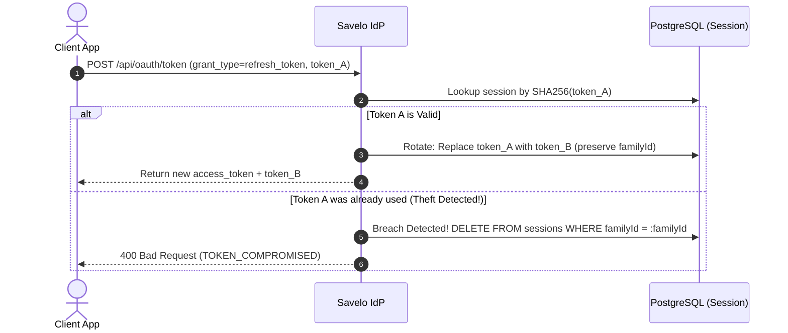

# Security & Cryptography Specification

This document details the cryptographic algorithms, security layers, anti-tampering measures, and timing protections implemented across **Savelo IdP**.

---

## 1. Cryptographic Algorithms & Standards

| Purpose | Algorithm / Primitive | Library / Module | Key Size / Entropy |
| :--- | :--- | :--- | :--- |
| **Token Signing** | RS256 (RSA Signature with SHA-256) | `jose` (Web Crypto) | 2048-bit RSA keypair |
| **OTP Hashing** | HMAC-SHA256 with Server Pepper | `crypto.createHmac` | Pepper: 32+ byte string |
| **Magic Link Tokens** | CSPRNG Random Bytes + SHA-256 | `crypto.randomBytes` | 32 bytes (256 bits) |
| **Refresh Tokens** | CSPRNG Random Bytes + SHA-256 | `crypto.randomBytes` | 40 bytes (320 bits) |
| **PKCE Validation** | RFC 7636 SHA-256 Base64URL | `crypto.createHash` | Verifier: 32-96 bytes |
| **Secret Verification**| Constant-Time String Equal | `crypto.timingSafeEqual` | Fixed-length buffer compare |

---

## 2. Asymmetric JWT Token Architecture (RS256)

Access and ID Tokens are signed using asymmetric cryptography. The private key remains strictly on the Savelo IdP server. Relying client applications verify tokens using public keys retrieved from `/.well-known/jwks.json`.

### A. Key Management (`lib/crypto/keys.ts`)
- **Production Requirement:** RSA private and public keys must be provided via `JWT_PRIVATE_KEY` and `JWT_PUBLIC_KEY` in PEM or Base64-encoded format.
- **Key Identifier (`kid`):** Every key pair is tagged with a `kid` (default: `savelo-idp-key-1`), propagated in the JWT header (`{"alg": "RS256", "kid": "...", "typ": "JWT"}`).
- **Key Rotation Support:** Client applications cache JWKS keys and re-fetch when receiving an unknown `kid`.
- **Local Fallback:** In non-production environments (`NODE_ENV !== "production"`), keys are automatically generated in-memory if environment variables are not supplied.

### B. Access Token Claims
Access tokens represent authorization to call protected APIs within the target client application:
```json
{
  "iss": "https://auth.savelo.web.id",
  "sub": "b2f698d2-45e0-4a8b-9679-d5952f1e29cb",
  "aud": "savelo-tools",
  "scope": "openid profile email",
  "jti": "59b48dc8-fb1c-4b36-a36c-9226cbdecebc",
  "iat": 1730880000,
  "exp": 1730880900
}
```
- **Lifetime:** Short-lived (15 minutes).
- **Cross-App Isolation:** The `aud` (Audience) claim is set to the specific `client_id`. Client applications **must reject** tokens where `aud !== client.clientId`.

### C. ID Token Claims (OpenID Connect)
ID tokens provide identity assertions about the authenticated user:
```json
{
  "iss": "https://auth.savelo.web.id",
  "sub": "b2f698d2-45e0-4a8b-9679-d5952f1e29cb",
  "aud": "savelo-tools",
  "email": "engineer@savelo.com",
  "email_verified": true,
  "nonce": "optional-client-nonce",
  "iat": 1730880000,
  "exp": 1730883600
}
```
- **Lifetime:** 1 hour.

---

## 3. Zero-Password Cryptographic Mechanics

### A. 6-Digit OTP with Server-Side Pepper
A 6-digit numeric OTP has only $10^6$ combinations. Plain SHA-256 or unkeyed hashing is vulnerable to precomputed rainbow tables:
1. **Generation:** Generated using cryptographically secure random integers (`crypto.randomInt(100000, 1000000)`).
2. **Peppered Hashing:**
   $$\text{otpHash} = \text{HMAC-SHA256}(\text{rawOtp}, \text{AUTH\_PEPPER\_SECRET})$$
3. **Storage:** The raw OTP is dispatched to the user (via SMS/WhatsApp/email) and **never stored**. Only `otpHash` is preserved in the transient Redis state.

### B. Magic Link Generation & Evasion
1. **Entropy:** 32 cryptographically secure random bytes converted to a hex string (64 characters).
2. **Storage:** Hashed with SHA-256 before saving to Redis:
   $$\text{magicLinkHash} = \text{SHA256}(\text{rawMagicToken})$$
3. **Scanner Evasion:** Corporate email security scanners pre-fetch GET links to inspect malware. To prevent scanner pre-consumption, the Magic Link route (`/verify`) renders a static confirmation button that dispatches a `POST` request to complete validation.

---

## 4. PKCE RFC 7636 Authorization Protocol

All authorization requests enforce Proof Key for Code Exchange (PKCE) to prevent authorization code interception attacks:

1. **Client Generation:**
   - Client generates a high-entropy string `code_verifier` (min 43, max 128 chars).
   - Client computes the challenge:
     $$\text{code\_challenge} = \text{BASE64URL}(\text{SHA256}(\text{code\_verifier}))$$
2. **IdP Association:**
   - The authorization endpoint receives `code_challenge` and `code_challenge_method=S256` and binds them to the generated authorization code in Redis.
3. **Token Exchange Verification:**
   - During `/api/oauth/token`, the client sends `code_verifier`.
   - IdP verifies:
     $$\text{timingSafeEqual}(\text{BASE64URL}(\text{SHA256}(\text{code\_verifier})), \text{storedChallenge})$$

---

## 5. Refresh Token Rotation (RTR) & Token Families

To protect long-lived sessions against refresh token theft, Savelo IdP implements Token Family tracking:



- Every refresh token exchange issues a **new** refresh token and invalidates the previous one.
- If a client or adversary attempts to replay an old/used refresh token, the server identifies a compromise and revokes the entire `familyId`, terminating all sessions for that device immediately.

---

## 6. Timing Attack & Anti-Enumeration Protections

### A. Constant-Time Comparisons (`lib/crypto/hash.ts`)
Standard string comparison (`===`) terminates on the first mismatched byte, creating timing side-channels that attackers can exploit.
All hashes (OTPs, client secrets, PKCE challenges) are evaluated using `crypto.timingSafeEqual`:
```typescript
export function timingSafeStringEqual(a: string, b: string): boolean {
  const bufA = Buffer.from(a, "utf-8");
  const bufB = Buffer.from(b, "utf-8");
  if (bufA.length !== bufB.length) return false;
  return crypto.timingSafeEqual(bufA, bufB);
}
```

### B. Anti-Enumeration Latency Masking (`lib/utils/anti-enumeration.ts`)
When initiating authentication via `/api/auth/initiate`, verifying whether an account exists could leak user presence if responses return faster for non-existent users:
- The handler executes inside `withConstantLatency(fn, targetMs = 300)`.
- If the database lookup and hash generation finish in 40ms, the response is artificially padded with jitter to normalize response times to ~300ms, defeating enumeration attacks.

---

## 7. Rate Limiting Architecture (`lib/utils/rate-limiter.ts`)

Redis-backed token bucket rate limits prevent brute force and SMS/Email toll fraud:

| Operation | Key Structure | Limit | Window | Action on Violation |
| :--- | :--- | :--- | :--- | :--- |
| **Auth Initiation** | `rl:initiate:{ip}:{identifier}` | 5 requests | 15 minutes (900s) | Rejection with `429 Too Many Requests` |
| **OTP Verification** | `auth:req:{sessionStateID}.attempts` | 3 attempts | 10 minutes | State deleted, lockout enforced |
| **Global IP Limiting** | `rl:verify:ip:{ip}` | 5 failures | 1 hour (3600s) | IP blocked from verification |
