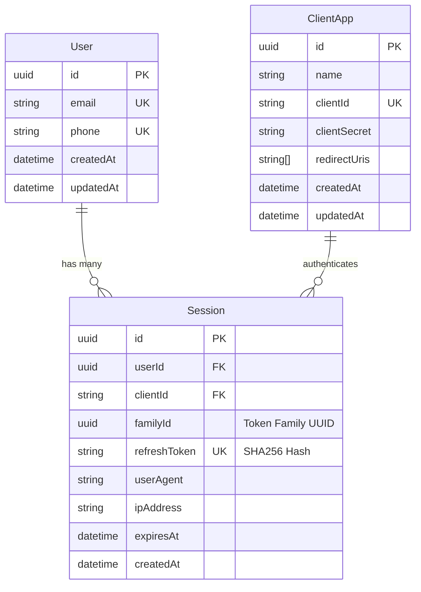

# Database Schema & Ephemeral State Model

This document outlines the dual-layer data architecture of **Savelo IdP**: durable relational persistence in **PostgreSQL** (via Prisma ORM) and high-throughput ephemeral state in **Redis**.

---

## 1. PostgreSQL Relational Model (Prisma)

PostgreSQL stores durable system records: registered users, client application credentials, and active token family sessions.

### A. Entity-Relationship Diagram



---

### B. Prisma Schema Definition (`prisma/schema.prisma`)

#### 1. `User` Model (`users` table)
Represents global user identities across the entire Savelo ecosystem:
```prisma
model User {
  id        String    @id @default(dbgenerated("gen_random_uuid()")) @db.Uuid
  email     String?   @unique
  phone     String?   @unique
  createdAt DateTime  @default(now())
  updatedAt DateTime  @updatedAt
  sessions  Session[]

  @@map("users")
}
```
- **Auto-Provisioning:** Users are automatically provisioned upon first verified login via `userRepository.autoProvision(identifier)`.
- **Identifiers:** Either `email` or `phone` (E.164 format) must be unique. Passwords do not exist in this model.

#### 2. `ClientApp` Model (`client_apps` table)
Represents relying OAuth 2.0 / OIDC client applications:
```prisma
model ClientApp {
  id           String    @id @default(dbgenerated("gen_random_uuid()")) @db.Uuid
  name         String    // e.g. "Savelo Tools", "Saveroute"
  clientId     String    @unique
  clientSecret String    // Stored as SHA-256 hash
  redirectUris String[]  // Whitelisted callback URLs
  createdAt    DateTime  @default(now())
  updatedAt    DateTime  @updatedAt
  sessions     Session[]

  @@map("client_apps")
}
```
- **Hashed Secrets:** `clientSecret` is stored exclusively as a SHA-256 hash. The plaintext raw secret is shown only once during creation in `/console` or seeded via `scripts/seed.ts`.
- **Callback Whitelisting:** `redirectUris` array enforces strict URI matching during the authorization and token exchange steps.

#### 3. `Session` Model (`sessions` table)
Tracks active user login sessions and Token Families for Refresh Token Rotation:
```prisma
model Session {
  id           String    @id @default(dbgenerated("gen_random_uuid()")) @db.Uuid
  userId       String    @db.Uuid
  clientId     String
  familyId     String    @db.Uuid // Token Family UUID for RTR breach detection
  refreshToken String    @unique  // SHA-256 hash of raw refresh token
  userAgent    String?
  ipAddress    String?
  expiresAt    DateTime
  createdAt    DateTime  @default(now())

  user   User      @relation(fields: [userId], references: [id], onDelete: Cascade)
  client ClientApp @relation(fields: [clientId], references: [clientId])

  @@index([userId])
  @@index([familyId])
  @@map("sessions")
}
```
- **Token Family Grouping:** `familyId` groups successive refresh tokens across continuous rotations.
- **Cascade Deletion:** Deleting a user purges all associated sessions automatically.

---

## 2. Redis Ephemeral State Machine

Short-lived authentication challenges, PKCE states, temporary authorization codes, and rate limits are managed in Redis to protect PostgreSQL from connection churn.

### A. Key Patterns & Data Structures

| Key Pattern | Data Structure | TTL | Description |
| :--- | :--- | :--- | :--- |
| `auth:req:{sessionStateID}` | JSON String | 600s (10 min) | Transient state for OTP & Magic Link challenge. |
| `auth:code:{code}` | JSON String | 180s (3 min) | Single-use authorization code data for PKCE exchange. |
| `auth:events:{sessionStateID}` | Pub/Sub Channel | Transient | Pushes verification events to waiting SSE clients. |
| `rl:initiate:{ip}:{identifier}` | String (Counter) | 900s (15 min) | Rate limiter bucket for auth initiation requests. |
| `rl:verify:ip:{ip}` | String (Counter) | 3600s (1 hr) | Rate limiter bucket for OTP verification failures. |
| `rtr:reused:{rawTokenHash}` | String Flag | 86400s (24 hr) | Fast-path cache for previously consumed refresh tokens. |

---

### B. Redis Payload Schemas

#### 1. `AuthRequestState` (`auth:req:{sessionStateID}`)
```typescript
interface AuthRequestState {
  sessionStateID: string;      // Unique UUID v4 identifying the challenge
  clientId: string;            // Initiating OAuth client
  identifier: string;          // Normalized email or phone
  otpHash: string;             // HMAC-SHA256(rawOtp, AUTH_PEPPER_SECRET)
  magicLinkHash: string;       // SHA256(rawMagicToken)
  attempts: number;            // Current failed attempts (max 3)
  isVerified: boolean;         // Verified state flag
  userId?: string;             // Populated upon verification
  authCode?: string;           // Issued authorization code
  codeChallenge?: string;      // PKCE challenge from client
  codeChallengeMethod?: string;// Usually "S256"
  redirectUri?: string;        // Callback URI
  state?: string;              // Client state parameter for CSRF
  nonce?: string;              // OIDC client nonce
  scope?: string;              // Requested OAuth scopes
  createdAt: number;           // Epoch timestamp in milliseconds
}
```

#### 2. `AuthorizationCodeData` (`auth:code:{code}`)
```typescript
interface AuthorizationCodeData {
  clientId: string;            // Bound client application
  userId: string;              // Authenticated user UUID
  redirectUri?: string;        // Bound redirect URI
  codeChallenge?: string;      // PKCE challenge for verification
  codeChallengeMethod?: string;// "S256"
  scope?: string;              // Scopes granted
}
```

---

## 3. Serverless Connection Management

Next.js Route Handlers run in serverless execution environments where multiple invocations can exhaust database and Redis connection limits if not pooled properly.

### A. Prisma Client Caching (`lib/db/prisma.ts`)
```typescript
const globalForPrisma = globalThis as unknown as { prisma?: PrismaClient };

export const prisma =
  globalForPrisma.prisma ??
  new PrismaClient({
    log: process.env.NODE_ENV === "development" ? ["query", "error", "warn"] : ["error"],
  });

if (process.env.NODE_ENV !== "production") globalForPrisma.prisma = prisma;
```

### B. Redis Client Caching (`lib/redis/redis.ts`)
```typescript
const globalForRedis = globalThis as unknown as { redis?: Redis };

export const redis =
  globalForRedis.redis ??
  new Redis(process.env.REDIS_URL || "redis://localhost:6379", {
    maxRetriesPerRequest: 3,
    enableReadyCheck: false,
    lazyConnect: true,
  });

if (process.env.NODE_ENV !== "production") globalForRedis.redis = redis;
```
