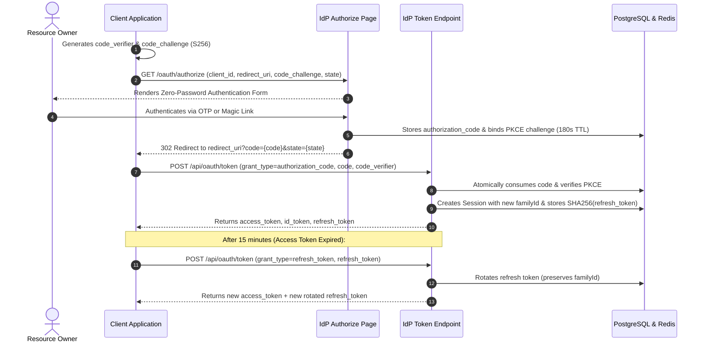

# OAuth 2.0 & OpenID Connect (OIDC) Lifecycle

This document describes the OAuth 2.0 and OpenID Connect (OIDC) protocols implemented in **Savelo IdP**, focusing on Authorization Code Grant with PKCE, Token Exchange, Refresh Token Rotation (RTR), and Token Revocation.

---

## 1. Protocol Architecture & Grant Flow

Savelo IdP strictly conforms to **RFC 6749** (OAuth 2.0), **RFC 7636** (PKCE), and the **OpenID Connect Core 1.0** specification:



---

## 2. Authorization Endpoint (`GET /oauth/authorize`)

Initiates the authentication ceremony:

### Request Query Parameters:
| Parameter | Type | Required | Description |
| :--- | :--- | :---: | :--- |
| `client_id` | String | Yes | Unique identifier of the registered client app. |
| `redirect_uri` | String | Yes | Must be pre-whitelisted in `client_apps.redirectUris`. |
| `response_type`| String | Yes | Must be `code`. |
| `scope` | String | No | Default: `openid profile email`. |
| `state` | String | Yes | Opaque client value to protect against CSRF attacks. |
| `code_challenge`| String | Yes | Base64URL-encoded SHA-256 hash of `code_verifier`. |
| `code_challenge_method`| String | Yes | Must be `S256`. |
| `nonce` | String | No | Client nonce passed through to the OIDC ID Token. |

### Validation Rules:
1. The `client_id` must exist in PostgreSQL.
2. The `redirect_uri` must strictly match an entry in the client's `redirectUris` array.
3. If valid, renders the zero-password login page (`app/oauth/authorize/page.tsx`).

---

## 3. Authorization Code Issuance & Redis Storage

Upon successful completion of OTP or Magic Link verification:
1. Savelo IdP generates a 32-character CSPRNG authorization code.
2. Code metadata is stored in Redis:
   - **Key:** `auth:code:{code}`
   - **TTL:** 180 seconds (3 minutes max).
   - **Payload:** `{ clientId, userId, redirectUri, codeChallenge, codeChallengeMethod, scope }`
3. The browser is redirected back to the client:
   ```http
   HTTP/1.1 302 Found
   Location: https://tools.savelo.web.id/api/auth/callback?code=b8a91c...&state=xyz123
   ```

---

## 4. Token Endpoint (`POST /api/oauth/token`)

The token endpoint handles code exchanges and refresh token rotations. It accepts `application/x-www-form-urlencoded` or `application/json`.

### A. Grant Type: `authorization_code`
Exchanges the single-use authorization code for JWT tokens:

#### Request Body Parameters:
- `grant_type`: `"authorization_code"`
- `client_id`: Initiating client ID.
- `client_secret`: Client secret (required for confidential clients).
- `code`: The authorization code received from the callback.
- `redirect_uri`: Must match the URI supplied during authorization.
- `code_verifier`: The raw PKCE secret string.

#### Execution Logic:
1. **Single-Use Atomic Consumption:** The authorization code is immediately deleted from Redis via `authStateRepository.consumeAuthorizationCode(code)`. If the code was already consumed or expired, rejects with `400 Bad Request (INVALID_OR_EXPIRED_CODE)`.
2. **Client Validation:** Checks `client_id` and verifies `client_secret` using constant-time comparison.
3. **PKCE Verification:** Computes `BASE64URL(SHA256(code_verifier))` and compares against `storedChallenge` with `crypto.timingSafeEqual`.
4. **Token Minting:**
   - Mints RS256 **Access Token** (15-minute expiration, `aud = client_id`).
   - Mints RS256 **ID Token** (1-hour expiration, contains user identity claims).
5. **Session Registration:**
   - Generates a 40-byte CSPRNG refresh token.
   - Generates a new `familyId` UUID.
   - Stores session record in PostgreSQL with `refreshToken = SHA256(rawRefreshToken)`.

---

### B. Grant Type: `refresh_token`
Refreshes access tokens and rotates refresh tokens:

#### Request Body Parameters:
- `grant_type`: `"refresh_token"`
- `client_id`: Registered client ID.
- `client_secret`: Client secret.
- `refresh_token`: The current raw refresh token.

#### Execution Logic:
1. **Hash Lookup:** Computes `SHA256(providedRefreshToken)` and looks up the session in PostgreSQL.
2. **Happy Path (Token Valid):**
   - Generates a new 40-byte raw refresh token.
   - Updates PostgreSQL session with `SHA256(newRawRefreshToken)` while **preserving the existing `familyId`**.
   - Mints new RS256 Access Token.
   - Returns `{ access_token, refresh_token, token_type: "Bearer", expires_in: 900 }`.
3. **Breach Path (Replayed/Stolen Token):**
   - If the presented refresh token cannot be found but matches an invalidated token family, or was already rotated:
   - Savelo IdP executes **Revoke Token Family**:
     ```text
     DELETE FROM "sessions" WHERE "familyId" = :familyId;
     ```
   - All sessions associated with that token family are terminated.
   - Responds with `400 Bad Request (TOKEN_COMPROMISED)`.

---

## 5. UserInfo Endpoint (`GET /api/oauth/userinfo`)

Retrieves profile assertions for an active access token:
- **Authorization:** `Bearer <access_token>`
- **Verification:** Token signature is verified against local private key or JWKS.
- **Audience Check:** Verifies `aud` claim matches the requesting service.
- **Response:**
  ```json
  {
    "sub": "b2f698d2-45e0-4a8b-9679-d5952f1e29cb",
    "email": "engineer@savelo.com",
    "email_verified": true,
    "phone": "+628123456789",
    "updated_at": 1730880000
  }
  ```

---

## 6. Token Revocation Endpoint (`POST /api/oauth/revoke`)

Implements **RFC 7009** token revocation:
- **Parameters:** `token`, `token_type_hint` (`refresh_token` or `access_token`), `client_id`, `client_secret`.
- Deletes the session and associated family from PostgreSQL.
- Responds with `200 OK` (revocation is always idempotent).

---

## 7. OIDC Discovery & JWKS

Savelo IdP exposes standard metadata endpoints:
- **Discovery Document:** `GET /api/.well-known/openid-configuration`
  Returns JSON metadata declaring supported scopes, response types, grant types, signing algorithms (`RS256`), and endpoint URLs.
- **JWKS Endpoint:** `GET /api/.well-known/jwks.json`
  Returns the public RSA 2048 keys formatted per RFC 7517:
  ```json
  {
    "keys": [
      {
        "kty": "RSA",
        "use": "sig",
        "alg": "RS256",
        "kid": "savelo-idp-key-1",
        "n": "...",
        "e": "AQAB"
      }
    ]
  }
  ```
